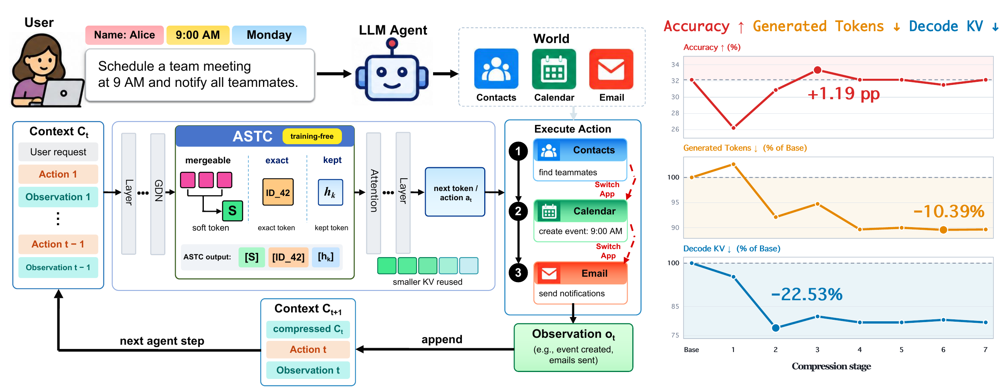
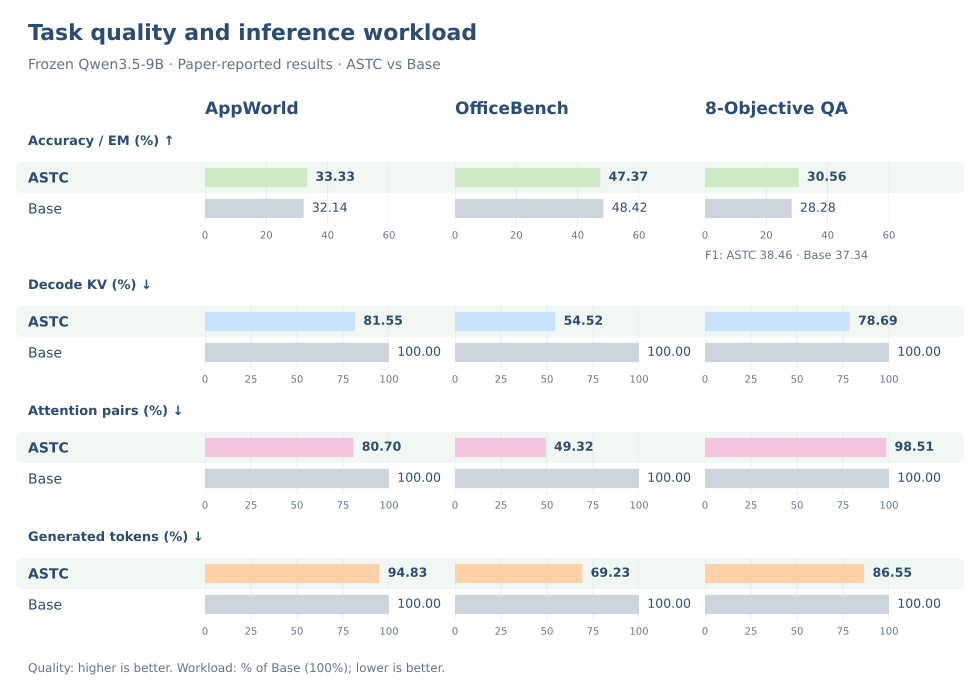

<div align="center">

<picture>
  <source media="(prefers-color-scheme: dark)" srcset="assets/readme-hero-dark.svg">
  
</picture>

<p>
  <strong>Compact context for long-horizon agents.</strong><br>
  Carry absorbed context forward as soft tokens, while keeping exact values explicit.
</p>

[](pyproject.toml)
[](https://github.com/RISE-X-Lab/Agentic-Soft-Token/actions/workflows/ci.yml)
[](LICENSE)

</div>

**Agentic Soft-Token Compression (ASTC)** lets the acting model compact information it has already absorbed while keeping exact values explicit. It uses the native recurrent dynamics of a hybrid Gated Delta Network (GDN)–attention model to select eligible context, merges selected hidden states into soft tokens, and reuses the compact KV cache across later agent steps. The backbone stays frozen; no compressor training or extra LLM calls are required.



## Highlights

- **Model-native selection.** Innovation and state-readability signals identify eligible content after the early layers have read the complete input.
- **Exact-value protection.** API catalogs, contracts, authentication results, and recognized literals remain explicit.
- **Persistent savings.** Later layers process a shorter sequence and reuse their compact caches during decoding and subsequent agent steps.
- **Reproducible AppWorld evaluation.** One frozen policy, a bundled zero-update calibration, 168 ordered task IDs, numerical reference results, and focused tests are included.

## Results

The manuscript reports the following Base–ASTC comparisons with a frozen Qwen3.5-9B acting model. Workload is relative to Base = 100%; lower is better.

<p align="center">
  <picture>
    <source media="(prefers-color-scheme: dark)" srcset="assets/benchmark-results-dark.svg">
    
  </picture>
</p>

**AppWorld is reproducible from this release:** Base succeeds on 54/168 tasks and ASTC on 56/168, with **18.45% fewer Decode KV interactions** and **19.30% fewer Attention Pairs**. `table --reference` recomputes these values from the bundled per-task CSV. These Test-Normal tasks were used during development; this is not a fresh blind test.

Decode KV and Attention Pairs count attention geometry, not measured latency or total-model FLOPs. See [metric definitions](docs/METRICS.md).

## Quick start

### Inspect results without a GPU

Python 3.11 or 3.12 is sufficient to print the bundled reference table; this command does not require third-party packages, model weights, or benchmark data.

```bash
git clone https://github.com/RISE-X-Lab/Agentic-Soft-Token.git
cd Agentic-Soft-Token
PYTHONPATH=src python -m stable_interfaces table --reference
```

### Install the inference environment

Use a Linux host with an NVIDIA GPU, CUDA 12.6, and enough memory for Qwen3.5-9B and its cache. Create a fresh Python 3.11/3.12 environment:

```bash
python -m venv .venv
source .venv/bin/activate
python -m pip install --upgrade pip
python -m pip install torch==2.7.0 --index-url https://download.pytorch.org/whl/cu126
python -m pip install triton==3.3.0
python -m pip install -e '.[cuda,evaluation,test]'
stable-interfaces doctor
stable-interfaces inspect
```

The evaluated stack pins PyTorch 2.7.0+cu126, Transformers 5.2.0, flash-linear-attention 0.4.1, Triton 3.3.0, causal-conv1d 1.7.0, and AppWorld 0.1.3.post1. The Python package and CLI retain the name `stable_interfaces` / `stable-interfaces` used by the released experiments.

Download [Qwen/Qwen3.5-9B](https://huggingface.co/Qwen/Qwen3.5-9B) at revision `c202236235762e1c871ad0ccb60c8ee5ba337b9a` and install the [official AppWorld data](https://github.com/StonyBrookNLP/appworld) separately. The AppWorld root must contain `data/tasks`; the evaluator and environment server must use the same data version. Model weights and benchmark data retain their respective licenses.

### Run a paired AppWorld check

Start an isolated environment server in one terminal:

```bash
python tools/serve_environment.py --root /path/to/appworld --port 37752
```

In another terminal, evaluate Base and ASTC sequentially against that server:

```bash
stable-interfaces evaluate --variant base \
  --model /path/to/Qwen3.5-9B --appworld-root /path/to/appworld \
  --environment-url http://127.0.0.1:37752 --output runs/base-check --limit 1

stable-interfaces evaluate --variant stable_interfaces \
  --model /path/to/Qwen3.5-9B --appworld-root /path/to/appworld \
  --environment-url http://127.0.0.1:37752 --output runs/astc-check --limit 1

stable-interfaces table --run base=runs/base-check \
  --run stable_interfaces=runs/astc-check --allow-partial
```

For the full 168-task comparison, remove `--limit 1`, use fresh output directories, and omit `--allow-partial` from the table command. Use one server per active evaluator when running parallel workers. The [reproduction guide](docs/REPRODUCIBILITY.md) covers seeds, sharding, calibration provenance, and CUDA checks.

## Repository layout

```text
Agentic-Soft-Token/
├── assets/                         # Logo, result graphics, and paper Figure 1
├── docs/                           # Method, metrics, reproduction
├── src/stable_interfaces/
│   ├── algorithm/                  # Selection, protection, bounded pooling
│   ├── runtime/                    # Frozen model, GDN signals, persistent caches
│   │   └── assets/                 # Calibration and agent protocol
│   └── assets/                     # Fixed policy, task IDs, numeric reference
├── tests/                          # CPU oracles and CUDA integration checks
├── tools/serve_environment.py      # Isolated AppWorld environment helper
└── pyproject.toml                  # Dependencies and CLI entry point
```


Run outputs can contain task instructions, tool results, and credentials. Keep `runs/` private; it is excluded from Git and package distributions.

## License

Original code, documentation, and bundled calibration are released under the [MIT License](LICENSE). Dependencies and separately obtained assets are covered in [third-party notices](THIRD_PARTY.md).
